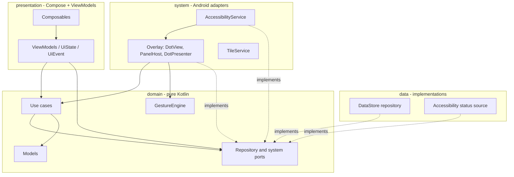
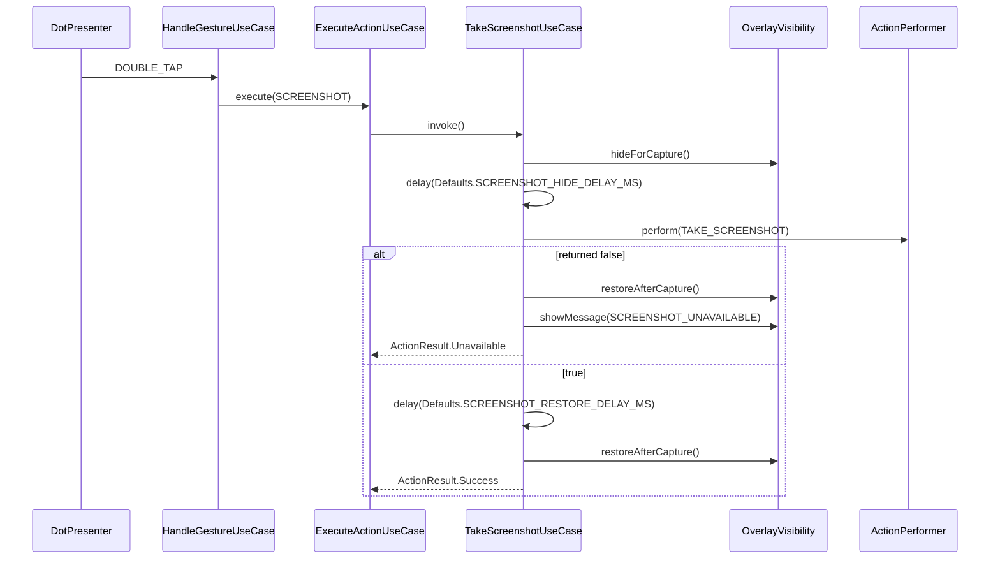

# Dotap — Architecture

Related: `PRD.md`, `ROADMAP.md`, `COMPLIANCE.md`, `AGENTS.md`.

## 1. Principles

Dotap uses **MVVM** with a pragmatic **layered (Clean) architecture**. The goals are testability, small focused classes, and a codebase an agent can change safely.

1. **Unidirectional data flow.** State flows down (`ViewModel` → UI), events flow up (UI → `ViewModel`).
2. **Dependency rule.** Dependencies point inward. `domain` knows nothing about Android, data storage, or UI.
3. **Depend on abstractions at boundaries.** Android-specific behavior (global actions, overlay, haptics, DataStore) sits behind interfaces ("ports") defined in `domain`.
4. **Pure logic is pure.** Gesture detection, screenshot sequencing, validation, and mapping are plain Kotlin and unit-tested on the JVM.
5. **No over-engineering.** One Gradle module, manual DI, and no use case that only forwards a call.

## 2. Layers and dependency rule



| Layer | Contains | May depend on | Must not depend on |
|---|---|---|---|
| `domain` | models, ports (interfaces), use cases, `GestureEngine` | Kotlin stdlib, coroutines | Android SDK, AndroidX (including `ViewModel`), Compose, DataStore |
| `data` | port implementations (DataStore, status checks) | `domain`, Android/AndroidX storage APIs | `presentation`, `system` |
| `presentation` | Composables, `ViewModel`s, `UiState`/`UiEvent`/`UiEffect`, theme | `domain` | `data`, `system` |
| `system` | `AccessibilityService`, overlay views, tile, adapters that implement system ports | `domain`, Android SDK | `presentation` (except the panel Compose UI, see 6.2) |

Wiring happens only in `DotapApp` / `AppContainer` (see section 9).

## 3. Package layout

```
com.ssajudn.dotap
├── DotapApp.kt                  Application class, owns AppContainer
├── di/
│   └── AppContainer.kt          manual dependency wiring, ViewModel factories
├── domain/                      pure Kotlin
│   ├── model/                   ActionType, GestureType, DotSettings, PanelSlot,
│   │                            ServiceStatus, ActionResult, Defaults, Limits
│   ├── gesture/                 GestureEngine, GestureConfig, Scheduler
│   ├── repository/              SettingsRepository, ServiceStatusRepository (interfaces)
│   ├── port/                    ActionPerformer, OverlayVisibility, PanelLauncher,
│   │                            HapticFeedback, DispatcherProvider (interfaces)
│   ├── status/                  ServiceConnectionTracker (live connection hint)
│   └── usecase/                 HandleGestureUseCase, ExecuteActionUseCase,
│                                TakeScreenshotUseCase, ObserveServiceStatusUseCase
├── data/
│   ├── settings/                DataStoreSettingsRepository, SettingsKeys, SettingsMapper
│   └── status/                  AccessibilityStatusRepository, AccessibilityStatusWatcher
├── presentation/
│   ├── common/                  ExpressiveComponents, NavigationItem, LabeledSwitchRow
│   ├── theme/                   Color, Shape, Theme, Type
│   ├── navigation/              DotapNavHost, Destinations, NavTransitions, ScreenViewModelFactories
│   ├── onboarding/              OnboardingRoute, OnboardingScreen, OnboardingViewModel, IntroStep
│   ├── home/                    HomeRoute, HomeScreen, HomeViewModel, HeroStatusCard, RestrictedSettingsDialog
│   ├── settings/                SettingsRoute, SettingsScreen, SettingsViewModel
│   ├── gestures/                GesturesRoute, GesturesScreen, GesturesViewModel, GestureActionsCard
│   ├── appearance/              AppearanceRoute, AppearanceScreen, AppearanceViewModel, DimensionsCard, LiveDotPreviewCard
│   ├── battery/                 BatteryGuidanceRoute, BatteryGuidanceScreen, BatteryGuidanceViewModel, BrandStepsCard, OemBrandExtensions
│   └── panel/                   PanelContent (Compose), PanelRoute, PanelViewModel, PanelUiState
├── system/
│   ├── service/                 DotapAccessibilityService, GlobalActionPerformer
│   ├── overlay/                 OverlayController, DotView, DotViewAnimations, DotPresenter, DotUiState,
│   │                            PanelHost, OverlayLifecycleOwner, DragMetrics
│   └── tile/                    DotapTileService
└── util/                        tiny helpers with no better home
```

Rules: one top-level class per file, file name equals class name, and each feature folder holds its own `Screen`, `ViewModel`, and `UiState` together.

## 4. MVVM conventions

### 4.1 Contract per screen

Every screen has these four types:

| Type | Role |
|---|---|
| `XxxUiState` | Immutable `data class` describing everything the screen shows. Has a sensible default for the loading state. |
| `XxxUiEvent` | `sealed interface` of user intents (`Clicked`, `Changed(value)`). |
| `XxxUiEffect` | `sealed interface` of one-off effects (navigate, open system settings, show a snackbar). Delivered through a `Channel` exposed as `Flow`. |
| `XxxViewModel` | Holds state, handles events, calls use cases and repositories. |

### 4.2 ViewModel rules

- Extends `androidx.lifecycle.ViewModel`. Gets collaborators through the constructor (use cases, repository interfaces, `DispatcherProvider`).
- **No `Context`, no `View`, no Android framework types** other than `ViewModel`/`SavedStateHandle`.
- Exposes **one** `val uiState: StateFlow<XxxUiState>` built with `stateIn(viewModelScope, SharingStarted.WhileSubscribed(5_000), initial)`.
- Exposes **one** entry point `fun onEvent(event: XxxUiEvent)`.
- Never exposes `MutableStateFlow`, `MutableSharedFlow`, or `Channel`.
- Maps domain models to UI state; formatting for display (units, labels) happens here or in the composable, not in `domain`.
- Does not contain business rules. Rules live in use cases or domain models.

Example (shape, not final code):

```kotlin
data class SettingsUiState(
    val settings: DotSettings = DotSettings.Default,
    val isLoading: Boolean = true,
)

sealed interface SettingsUiEvent {
    data class DoubleTapActionSelected(val action: ActionType) : SettingsUiEvent
    data class DoubleTapTimeoutChanged(val millis: Int) : SettingsUiEvent
}

class SettingsViewModel(
    private val settingsRepository: SettingsRepository,
) : ViewModel() {

    val uiState: StateFlow<SettingsUiState> = settingsRepository.settings
        .map { SettingsUiState(settings = it, isLoading = false) }
        .stateIn(viewModelScope, SharingStarted.WhileSubscribed(5_000), SettingsUiState())

    fun onEvent(event: SettingsUiEvent) {
        viewModelScope.launch {
            when (event) {
                is SettingsUiEvent.DoubleTapActionSelected ->
                    settingsRepository.update { it.copy(doubleTapAction = event.action) }
                is SettingsUiEvent.DoubleTapTimeoutChanged ->
                    settingsRepository.update { it.withDoubleTapTimeout(event.millis) }
            }
        }
    }
}
```

`DotSettings.withDoubleTapTimeout` clamps to `Limits` inside the domain model, so validation is not duplicated in the UI.

### 4.3 Composable rules

- Two composables per screen: a **Route** that obtains the ViewModel and collects state, and a **stateless Screen** that takes `state` and `onEvent` only.

```kotlin
@Composable
fun SettingsRoute(viewModel: SettingsViewModel) {
    val state by viewModel.uiState.collectAsStateWithLifecycle()
    SettingsScreen(state = state, onEvent = viewModel::onEvent)
}

@Composable
fun SettingsScreen(state: SettingsUiState, onEvent: (SettingsUiEvent) -> Unit) { /* UI only */ }
```

- Stateless screens must have `@Preview`s. No business logic, no repository access, no `remember`ed state that duplicates ViewModel state (UI-only state like scroll or text-field focus is fine).
- Pass lambdas and primitives down, not ViewModels.
- Every interactive element has a `contentDescription` or semantic role.
- Collect effects with `LaunchedEffect` inside the Route, never inside the stateless Screen.

### 4.4 Navigation

Navigation Compose with a small `NavHost` (Onboarding, Home, Settings sub-screens). Routes are type-safe objects. Navigation decisions come from `UiEffect`s or Route-level callbacks, not from deep inside composables.

## 5. Domain layer

### 5.1 Models (immutable, validated)

- `ActionType` (enum): `SCREENSHOT, HOME, BACK, RECENTS, NOTIFICATIONS, QUICK_SETTINGS, POWER_DIALOG, LOCK_SCREEN, OPEN_PANEL, NONE` (later `LAUNCH_APP`, `FLASHLIGHT`).
- `GestureType`: `SINGLE_TAP, DOUBLE_TAP, LONG_PRESS`.
- `DotSettings`: all user settings; `copy`-based; `with...` methods clamp to `Limits`; `DotSettings.Default` built from `Defaults`.
- `ServiceStatus`: `DISABLED`, `ENABLED_CONNECTED`, `ENABLED_NOT_CONNECTED`.
- `ActionResult`: sealed (`Success`, `Unavailable(reason)`, `Failed`).
- `Defaults` and `Limits`: all numeric constants (sizes, timeouts, opacity bounds, hide/restore delays). **No magic numbers elsewhere.**

### 5.2 Ports (interfaces)

| Port | Purpose | Implemented in |
|---|---|---|
| `SettingsRepository` | `val settings: Flow<DotSettings>`, `suspend fun update(transform)` | `data/settings` |
| `ServiceStatusRepository` | `val status: Flow<ServiceStatus>` | `data/status` |
| `ActionPerformer` | `fun perform(globalAction: GlobalAction): Boolean` | `system/service/GlobalActionPerformer` |
| `OverlayVisibility` | `hideForCapture()`, `restoreAfterCapture()`, `showMessage(MessageType)` | `system/overlay/OverlayController` |
| `PanelLauncher` | `fun open()`, `fun close()` | `system/overlay/PanelHost` |
| `HapticFeedback` | `fun tick()` | `system/overlay` |
| `DispatcherProvider` | `main`, `io`, `default` | `di/` |

### 5.3 Use cases

A use case exists only when it holds logic or combines sources. **No pass-through use cases**: ViewModels may call repository interfaces directly for simple reads and writes.

| Use case | Responsibility |
|---|---|
| `HandleGestureUseCase` | Given a `GestureType`, read the current settings, find the assigned action, trigger haptics, run `ExecuteActionUseCase` |
| `ExecuteActionUseCase` | Route an `ActionType` to the right behavior: global action, `TakeScreenshotUseCase`, `PanelLauncher`, no-op |
| `TakeScreenshotUseCase` | Hide overlay, wait, perform screenshot, restore, report `ActionResult` (see 7) |
| `ObserveServiceStatusUseCase` | Combine the system enabled-services list with the live connection tracker into `ServiceStatus` |

Use cases are classes with a single `operator fun invoke(...)`. Time-based logic uses `kotlinx.coroutines.delay` so tests can run in virtual time (`runTest`).

### 5.4 `GestureEngine`

Custom detector, not Android's `GestureDetector`, because timeouts must be configurable. Pure Kotlin in `domain/gesture`.

Inputs: `down(x, y, timeMs)`, `move(x, y, timeMs)`, `up(timeMs)`, `cancel()`. Injected: `Scheduler` (post delayed, cancel) and a `GestureConfig` (double-tap timeout, long-press duration, touch slop, whether double tap and long press are assigned).

Outputs through a listener: `onSingleTap`, `onDoubleTap`, `onLongPress`, `onDragStart`, `onDrag(dx, dy)`, `onDragEnd`.

State machine:

```
IDLE --down--> PRESSED
PRESSED --move > slop--> DRAGGING        (cancel long-press timer and pending tap)
PRESSED --long-press timer--> LONG_FIRED (emit onLongPress; ignore the following up)
PRESSED --up--> WAIT_SECOND_TAP
    if double tap not assigned: emit onSingleTap immediately -> IDLE
    else: start double-tap timer
WAIT_SECOND_TAP --down within timeout--> SECOND_PRESSED
SECOND_PRESSED --up--> emit onDoubleTap -> IDLE
WAIT_SECOND_TAP --timer expires--> emit onSingleTap -> IDLE
DRAGGING --up--> emit onDragEnd -> IDLE
```

Edge cases to test: drag after first tap, long press on second tap, config change mid-gesture, `cancel()` in every state.

## 6. Presentation and system under MVVM

### 6.1 Compose screens (onboarding, home, settings)

Standard MVVM as in section 4. ViewModels are created through factories in `AppContainer`.

### 6.2 The overlay is MVVM too

A `Service` has no `ViewModelStore`, so the overlay uses the **same contract** with plain classes:

- `DotUiState` (immutable): visible, side, y-ratio, size, alpha, hiddenForCapture.
- `DotPresenter` (plain class, scoped to the service coroutine scope): owns `StateFlow<DotUiState>`, receives gesture callbacks from `GestureEngine`, calls `HandleGestureUseCase`, and updates position on drag. The service collects `SettingsRepository.settings` and calls `DotPresenter.applySettings`.
- `DotView` (plain `View`): **renders** `DotUiState`, forwards raw touch events. Uses `DotViewAnimations` to manage fluid idle breathing and panel-open/close morphing transitions with bounds padding to prevent edge clipping.
- `OverlayController`: the `WindowManager` adapter. Adds/removes/updates the window, applies exclusion rects, implements `OverlayVisibility`, and reports settled positions through `onPositionSettled` so the service can persist them.

The **panel** is Compose, so it can use a real `PanelViewModel`:

- `PanelHost` adds a `ComposeView` as an accessibility overlay.
- Compose outside an Activity needs lifecycle owners. `OverlayLifecycleOwner` implements `LifecycleOwner`, `SavedStateRegistryOwner`, and `ViewModelStoreOwner`. Set `setViewTreeLifecycleOwner`, `setViewTreeSavedStateRegistryOwner`, and `setViewTreeViewModelStoreOwner` on the `ComposeView` before adding it. Drive lifecycle `CREATE → START → RESUME` on show and `PAUSE → STOP → DESTROY` on remove; clear the `ViewModelStore` on destroy.
- `PanelViewModel` exposes `PanelUiState` (slots) and handles `PanelUiEvent.SlotSelected` by calling `ExecuteActionUseCase`, then emitting a close effect.
- Layout: rounded container, 3×3 grid with the centre cell as Close, up to 8 action icons, positioned near the dot and clamped to the screen. Dismiss on outside touch (scrim) and on Back.

### 6.3 `DotapAccessibilityService`

- Extends `AccessibilityService`. `onAccessibilityEvent` is **empty**; `onInterrupt` does nothing.
- `onServiceConnected`: gets the `AppContainer`, marks `ServiceConnectionTracker` connected, builds `OverlayController`, `DotPresenter`, `GlobalActionPerformer`, and starts collecting.
- `onUnbind` / `onDestroy`: removes overlay and panel, cancels its `CoroutineScope(SupervisorJob() + main)`, marks the tracker disconnected.
- It is a thin Android entry point: it wires objects and forwards lifecycle. It holds no business logic.

### 6.4 `DotapTileService` (P2)

Quick Settings tile that toggles `dotEnabled` through `SettingsRepository`. Tile state is derived from settings and `ServiceStatus`.

## 7. Screenshot flow



Unit tests (virtual time) assert call order, delays, and that the dot is always restored, including when `perform` throws.

## 8. Data layer

### 8.1 `DataStoreSettingsRepository`

Implements `SettingsRepository` with DataStore Preferences. `SettingsMapper` converts between stored keys and `DotSettings`; unknown or out-of-range values fall back to defaults and are clamped.

| Key | Type | Default |
|---|---|---|
| `dot_enabled` | Boolean | true |
| `dot_size_dp` | Int | 48 |
| `idle_opacity_pct` | Int | 40 |
| `idle_delay_ms` | Int | 3000 |
| `double_tap_timeout_ms` | Int | 300 |
| `long_press_ms` | Int | 500 |
| `action_single` | ActionType name | HOME (OPEN_PANEL once the panel ships) |
| `action_double` | ActionType name | SCREENSHOT |
| `action_long` | ActionType name | NONE |
| `panel_slots` | ordered list (comma string) | HOME,BACK,RECENTS,SCREENSHOT,NOTIFICATIONS,QUICK_SETTINGS |
| `haptics_enabled` | Boolean | true |
| `snap_to_edge` | Boolean | true |
| `dot_side` | LEFT/RIGHT | RIGHT |
| `dot_y_ratio` | Float | 0.4 |

### 8.2 Service status

`AccessibilityStatusRepository` implements `ServiceStatusRepository`. The **system enabled-services list is the source of truth** (read-only: `AccessibilityManager.getEnabledAccessibilityServiceList` or the enabled-services secure setting), because the process can die while the service stays enabled. `ServiceConnectionTracker` (a `StateFlow<Boolean>` owned by `AppContainer`, set by the service) is a live hint that distinguishes `ENABLED_CONNECTED` from `ENABLED_NOT_CONNECTED`. There is **no global singleton state**.

To ensure the in-app UI (such as `HeroStatusCard` on `HomeScreen`) reacts immediately when the user enables or disables the service in Android Settings, `AccessibilityStatusWatcher` observes:
1. `ContentObserver` on `Settings.Secure.ENABLED_ACCESSIBILITY_SERVICES` and `Settings.Secure.ACCESSIBILITY_ENABLED`.
2. `AccessibilityManager.AccessibilityStateChangeListener` and `AccessibilityServicesStateChangeListener` (API 33+).
3. `Application.ActivityLifecycleCallbacks` on `MainActivity.onActivityResumed` to guarantee an instant re-check whenever the app returns to the foreground.

## 9. Dependency injection

Manual DI, no framework in v1.

- `DotapApp` creates `AppContainer` once.
- `AppContainer` lazily builds: `DispatcherProvider`, `DataStore`, `SettingsRepository`, `ServiceStatusRepository`, `ServiceConnectionTracker`, and the use cases that do not need system adapters.
- ViewModel factories (`viewModelFactory { initializer { ... } }`) are exposed by the container.
- System adapters (`OverlayController`, `GlobalActionPerformer`) are created by `DotapAccessibilityService` when it connects, then passed into use cases that need them. The service reaches the container via `(applicationContext as DotapApp).container`. This single service-locator-style lookup at the Android entry point is the only allowed one.
- Adding Hilt or Koin is an "ask first" change (`../AGENTS.md`).

## 10. Threading and dispatchers

- Overlay and view work on the main thread.
- DataStore does its own IO; collected on main.
- Code never references `Dispatchers.*` directly. It uses the injected `DispatcherProvider`, so tests can replace it.
- Delays use `delay` inside coroutines, so `runTest` controls time.

## 11. Manifest and service config

`AndroidManifest.xml` (relevant parts):

```xml
<service
    android:name=".system.service.DotapAccessibilityService"
    android:exported="true"
    android:label="@string/service_label"
    android:permission="android.permission.BIND_ACCESSIBILITY_SERVICE">
    <intent-filter>
        <action android:name="android.accessibilityservice.AccessibilityService" />
    </intent-filter>
    <meta-data
        android:name="android.accessibilityservice"
        android:resource="@xml/accessibility_service_config" />
</service>
```

`res/xml/accessibility_service_config.xml` (MVP):

```xml
<accessibility-service
    xmlns:android="http://schemas.android.com/apk/res/android"
    android:description="@string/service_description"
    android:accessibilityFeedbackType="feedbackGeneric"
    android:canRetrieveWindowContent="false"
    android:canTakeScreenshot="true"
    android:settingsActivity=".MainActivity" />
```

Notes:

- No `accessibilityEventTypes` and no window content access. This keeps the service from observing other apps, which is the basis of the Play disclosure (`COMPLIANCE.md`).
- Verify on real devices that the service stays connected with no event types. If an OEM disconnects it, add the narrowest possible event type, keep ignoring all events in code, and record it in `COMPLIANCE.md`.
- `canTakeScreenshot="true"` is enabled for `GLOBAL_ACTION_TAKE_SCREENSHOT` (API 30+), disclosed in `COMPLIANCE.md`. `canPerformGestures="true"` is **not** in the MVP; add it only with human approval and a disclosure update.
- Overlay window params (starting point): type `TYPE_ACCESSIBILITY_OVERLAY`, flags `FLAG_NOT_FOCUSABLE | FLAG_LAYOUT_NO_LIMITS`, format `PixelFormat.TRANSLUCENT`, gravity `TOP | START`. Set `systemGestureExclusionRects` on the dot (API 29+).
- No `INTERNET`, no `SYSTEM_ALERT_WINDOW`, no foreground service.

## 12. Failure handling

| Failure | Behavior |
|---|---|
| `performGlobalAction` returns `false` | `ActionResult.Unavailable`; restore dot, show brief message, debug log only |
| `perform` throws | Caught at the `system` adapter, mapped to `ActionResult.Failed`; dot is restored in `finally` |
| `BadTokenException` adding overlay | Catch in `OverlayController`, mark overlay unavailable, retry on next config change |
| Service disconnected while panel open | Remove panel and dot, clear state |
| Stored settings corrupted or out of range | Fall back to defaults / clamp |
| Display changed (rotation, fold) | Re-clamp dot position, close the panel |

Catch specific exceptions only at system boundaries. Never swallow exceptions silently.

## 13. Clean code standards

These are enforced by review and by tooling (`spotlessCheck`, `detekt`).

1. **Names reveal intent.** `takeScreenshot()`, not `doAction2()`. No abbreviations beyond common units (`dp`, `ms`).
2. **Small functions, one level of abstraction.** Guideline: at most about 25 lines and at most 4 parameters (otherwise introduce a parameter object).
3. **Single responsibility.** A class has one reason to change. Files stay under about 300 lines.
4. **No magic numbers or strings.** Constants live in `Defaults` and `Limits` (domain) or `strings.xml`.
5. **Immutability by default.** `val`, `data class`, `copy`, immutable collections in public APIs.
6. **No `!!`.** Model absence with nullable types handled explicitly or with sealed results.
7. **Explicit errors.** Return `ActionResult`/sealed types for expected failures. Use exceptions only for programmer errors and at system boundaries.
8. **Comments explain why, not what.** Delete dead and commented-out code. KDoc on domain ports and non-obvious public functions.
9. **DRY without premature abstraction.** Extract on the third repetition, not the second.
10. **Composition over inheritance.** Interfaces at boundaries; inject collaborators through constructors.
11. **Minimal visibility.** `private` and `internal` by default; expose only what other layers need.
12. **Formatting is automated.** No manual style debates; run the formatter.
13. **Boy-scout rule.** Leave touched code a little cleaner, but keep unrelated refactors out of the same commit.

Static analysis starting thresholds (tune with the human): `LongMethod` 30, `CyclomaticComplexMethod` 10, `LongParameterList` 4 for functions, `MagicNumber` enabled (tests excluded), `TooManyFunctions` per the detekt defaults.

## 14. Testing strategy

| Layer | Approach |
|---|---|
| `GestureEngine` | JVM unit tests with a fake `Scheduler`; table-driven cases for every transition |
| Use cases | JVM unit tests with hand-written fakes for ports and `runTest` virtual time; assert call order, delays, and error paths |
| Domain models | Unit tests for defaults, clamping, `with...` methods |
| ViewModels | Unit tests with fake repositories, an injected test `DispatcherProvider`, and Turbine for `StateFlow`/effects |
| `data` | `DataStoreSettingsRepository` tested against a temp-file DataStore; mapper tests for defaults and bad values |
| Compose screens | `@Preview` for each stateless screen; a few UI tests for onboarding consent gating |
| `system` (service, overlay) | Manual QA checklist in `ROADMAP.md` on real devices |

Prefer **fakes over mocks**; no mocking library is needed. Target: all domain and ViewModel logic covered by unit tests (aim for 80% or more line coverage there).

## 15. Build configuration

- Single module `app`, Gradle Kotlin DSL, version catalog. Plugins for formatting (Spotless with ktlint) and static analysis (detekt) are part of the build.
- `minSdk` 28; `compileSdk` and `targetSdk` latest stable.
- Release: R8 minify and resource shrinking on; minimal keep rules.
- No `INTERNET` permission in any build type.

## 16. Extension points

- Own capture (`takeScreenshot`, API 30+): new `CaptureScreenshotUseCase` behind a feature flag; needs `canTakeScreenshot`, MediaStore saving, and a disclosure update.
- Custom gestures: needs `canPerformGestures` and `dispatchGesture`; same disclosure caveat. Add a `GesturePerformer` port.
- Launch-app and flashlight actions: extend `ActionType` and `ExecuteActionUseCase`, with new ports if they touch Android APIs.
